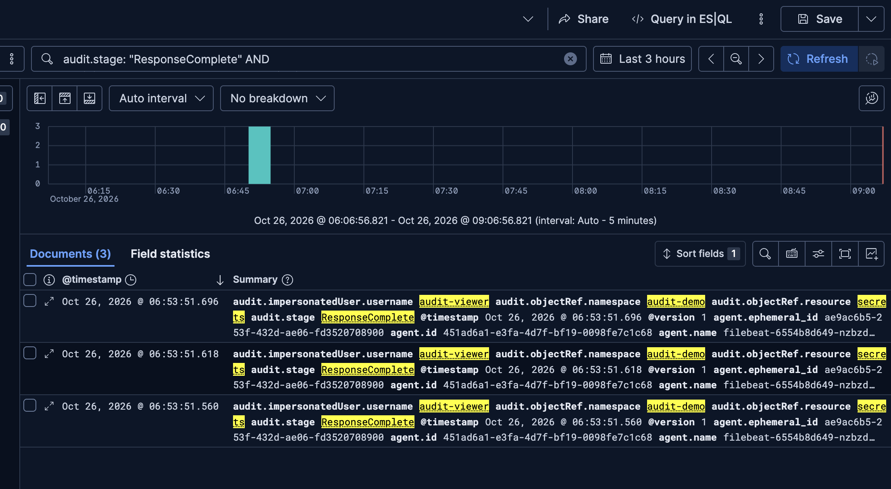

# Kubernetes Audit Logging

## Purpose and environment

This setup records Kubernetes API requests and makes them searchable in Kibana. Audit logs show who made a request, which resource they accessed, when it happened, and whether it was allowed. This helps investigate unexpected changes and attempts to access resources outside a user's permissions.

The lab runs on an AWS EC2 `m7i-flex.large` instance with Ubuntu 24.04, 8 GiB RAM, and a 30 GiB encrypted gp3 disk. Kubernetes runs in a single-node kind cluster named `django-audit`.

Installed versions: kind `0.31.0`, Kubernetes and kubectl `1.35.0`, Helm `4.3.1`, and Elastic Stack `9.5.5`.

The collection path is:

```text
Kubernetes API server → audit files → Filebeat → Logstash → Elasticsearch → Kibana
```

## Files

```text
k8s_audit_logging/
├── README.md
├── values/
│   ├── elasticsearch.yaml
│   ├── kibana.yaml
│   ├── logstash-config.yaml
│   └── filebeat.yaml
├── infra/
│   ├── audit-policy.yaml
│   └── kind-config.yaml
├── chart/
│   ├── Chart.yaml
│   ├── values.yaml
│   └── templates/resources.yaml
└── images/
    └── audit-denied-secrets.png
```

The four required values files configure the components of one small Helm chart. The chart and infrastructure files are included so the deployment can be reproduced. The older standalone Elastic Helm chart repository is [archived](https://github.com/elastic/helm-charts); this lab uses official container images directly.

## Audit configuration

`infra/audit-policy.yaml` contains a catch-all rule at the `Metadata` level. It covers resource and non-resource API requests, including denied requests, without recording request or response bodies. This provides the information needed for this exercise without copying Secret contents into the logs. [Kubernetes auditing documentation](https://kubernetes.io/docs/tasks/debug/debug-cluster/audit/).

`infra/kind-config.yaml` mounts the policy into the API server and enables the file backend at `/var/log/kubernetes/audit/audit.log`. Files rotate at 10 MiB, with up to two backups and a maximum backup age of one day. Size-based rotation can remove older records sooner.

No audit stages are omitted. A request can therefore produce both `RequestReceived` and `ResponseComplete` events with the same `auditID`. Event counts are not the same as request counts.

### Create the cluster

On the Mac, from the repository root, set the server address and copy the files:

```bash
django_audit_public_ip="<EC2_PUBLIC_IP>"

scp -i "$HOME/.ssh/kubernetes-audit" \
  -r ./k8s_audit_logging \
  ubuntu@"$django_audit_public_ip":/home/ubuntu/
```

The server needs Docker, kind, kubectl, and Helm installed. Set the Elasticsearch kernel prerequisite on Ubuntu:

```bash
echo 'vm.max_map_count=1048576' \
  | sudo tee /etc/sysctl.d/99-elasticsearch.conf
sudo sysctl -p /etc/sysctl.d/99-elasticsearch.conf
```

Run on Ubuntu:

```bash
cd /home/ubuntu/k8s_audit_logging

kind create cluster \
  --name django-audit \
  --image kindest/node:v1.35.0@sha256:452d707d4862f52530247495d180205e029056831160e22870e37e3f6c1ac31f \
  --config infra/kind-config.yaml \
  --wait 180s

kubectl --context kind-django-audit get namespaces
docker exec django-audit-control-plane \
  tail -n 2 /var/log/kubernetes/audit/audit.log
```

The test produced matching `RequestReceived` and `ResponseComplete` records for listing namespaces, with response code `200`.

## Log collection and analysis stack

Filebeat runs on the control-plane node and reads `audit*.log`, including rotated files. It mounts only the audit directory for reading and keeps its read position in `/var/lib/filebeat-audit` on the node. It runs as root to read the audit files, with privilege escalation disabled, all capabilities dropped, a read-only root filesystem, and no ServiceAccount token.

Logstash receives Filebeat events on port `5044`, parses the JSON into the `audit` field, and sets `@timestamp` from `audit.stageTimestamp`. It writes to daily `k8s-audit-*` indices. Elasticsearch uses an 8 GiB PVC; Kibana provides the search interface. Each component runs one replica with CPU and memory limits.

### Deploy

On Ubuntu, from `/home/ubuntu/k8s_audit_logging`, first install Elasticsearch and Kibana:

```bash
helm upgrade --install audit-logging ./chart \
  --kube-context kind-django-audit \
  --namespace audit-logging --create-namespace \
  -f values/elasticsearch.yaml -f values/kibana.yaml \
  --wait --timeout 10m
```

Create an index template with one primary shard and no replicas for this single-node lab:

```bash
kubectl --context kind-django-audit -n audit-logging \
  exec deployment/elasticsearch -- \
  curl -fsS -X PUT http://localhost:9200/_index_template/k8s-audit \
  -H 'Content-Type: application/json' \
  -d '{"index_patterns":["k8s-audit-*"],"template":{"settings":{"number_of_shards":1,"number_of_replicas":0}}}'
```

Then apply all four values files together:

```bash
helm lint ./chart \
  -f values/elasticsearch.yaml -f values/kibana.yaml \
  -f values/logstash-config.yaml -f values/filebeat.yaml

helm upgrade --install audit-logging ./chart \
  --kube-context kind-django-audit --namespace audit-logging \
  -f values/elasticsearch.yaml -f values/kibana.yaml \
  -f values/logstash-config.yaml -f values/filebeat.yaml \
  --wait --timeout 10m

kubectl --context kind-django-audit -n audit-logging get pods,pvc
kubectl --context kind-django-audit -n audit-logging \
  exec deployment/elasticsearch -- \
  curl -fsS 'http://localhost:9200/_cat/indices/k8s-audit-*?v'
```

Lint passed, all four Pods reached `1/1 Running`, and the PVC was `Bound`. The first indexing check showed the green index `k8s-audit-2026.10.26` containing 8,253 documents.

### Open Kibana

On the Mac, keep this command running:

```bash
ssh -i "$HOME/.ssh/kubernetes-audit" \
  -o ServerAliveInterval=30 -o ServerAliveCountMax=3 \
  -o ExitOnForwardFailure=yes \
  -L 127.0.0.1:5601:127.0.0.1:15601 \
  ubuntu@"$django_audit_public_ip" \
  'kubectl --context kind-django-audit -n audit-logging port-forward --address 127.0.0.1 service/kibana 15601:5601'
```

Open `http://localhost:5601`. Create the `Kubernetes audit` Data View with index pattern `k8s-audit-*` and timestamp field `@timestamp`. In Discover, select that Data View and use KQL to filter events. [Data View documentation](https://www.elastic.co/docs/explore-analyze/find-and-organize/data-views/create-data-view).

## Analysis exercise: repeated attempts to read a Secret

The hypothetical scenario is an account with permission to view Pods attempting to read a Secret. The exercise uses impersonation to simulate that account; it is not evidence of an actual compromised account.

Run on Ubuntu:

```bash
kubectl --context kind-django-audit create namespace audit-demo
kubectl --context kind-django-audit -n audit-demo \
  create secret generic audit-demo-secret --from-literal=token=example-value
kubectl --context kind-django-audit -n audit-demo \
  create role audit-viewer --verb=get,list,watch --resource=pods
kubectl --context kind-django-audit -n audit-demo \
  create rolebinding audit-viewer --role=audit-viewer --user=audit-viewer
kubectl --context kind-django-audit -n audit-demo \
  get pods --as=audit-viewer

for django_audit_attempt in 1 2 3; do
  kubectl --context kind-django-audit -n audit-demo \
    get secret audit-demo-secret --as=audit-viewer
done
```

The Pod query is permitted. The three Secret requests are expected to return `Forbidden`. In Discover, use a time range covering the test and this query:

```text
audit.stage: "ResponseComplete" AND
audit.impersonatedUser.username: "audit-viewer" AND
audit.objectRef.namespace: "audit-demo" AND
audit.objectRef.resource: "secrets" AND
audit.responseStatus.code: 403
```

Discover returned three matching events on 26 October 2026:



The analysis checks the effective identity, target resource, verb, response code, and timestamps. `audit.user.username` identifies the authenticated administrator who ran the simulation; `audit.impersonatedUser.username` identifies `audit-viewer`. Filtering on `ResponseComplete` avoids counting the initial request stage as another attempt.

The repeated denied requests are a reason to investigate activity outside the account's assigned permissions. The `403` responses show that these requests were blocked; they do not show a successful Secret read or prove malicious intent. In a real investigation, the next checks would be the source IP, user agent, surrounding requests, and whether this activity was expected.

## Lab limits

Elasticsearch authentication is disabled in this lab. Services use internal `ClusterIP` addresses, and browser access uses an SSH tunnel; the EC2 security group permits SSH from the administrator's IP. A production deployment would need authenticated access and TLS between components.

The index PVC and Filebeat registry survive Pod replacement but remain local to the kind node. They do not provide an off-node backup. Index retention, automated alerts, and durable forwarding queues were not configured. Local audit-file rotation and a single-node stack are sufficient for this exercise, not for a production audit archive.
